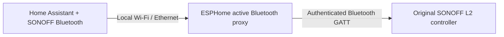

# SONOFF Bluetooth for Home Assistant

[](https://github.com/RenierM26/sonoff_bluetooth/actions/workflows/ci.yml)
[](LICENSE)

Local Bluetooth control of a **SONOFF L2 LED strip (UIID 137)** with its original
firmware. Provides a native Home Assistant RGB light with **on/off, colour and brightness**,
a **refresh button**, preset effects, controller rhythm and speed/sensitivity controls.
Currently supports L2 only; the repository name does **not** imply compatibility
with every SONOFF Bluetooth product. L2 Lite, L1 and L3 have not been verified.

The protocol has been tested on a physical L2 through an ESPHome Sonoff M5 proxy:
authentication, on/off, red/30%, blue/60%, and restoration all passed. Subsequent
Bluetooth state reports matched, and the owner confirmed the visible output.
The owner also tested the installed HA integration: effects, rhythm, speed,
sound reaction and 60-second state polling work on this L2. Long-run, power-cycle
and Internet-blocked testing remain separate checks.

## How it works



A nearby USB Bluetooth adapter on the HA host can replace the proxy. HA manages
adapter selection and existing ESPHome proxies; **do not disable your ESPHome
integration for routine use**. No custom firmware is required on the L2. There are
no eWeLink cloud calls or Wi-Fi light commands during normal control. Optional
**token-based setup** contacts eWeLink once to obtain credentials. The bridge
still uses the local network.

## Requirements

- Home Assistant **2026.10.4**, the latest stable release checked on 2026-11-01.
  We target the latest stable HA release only; older releases are not supported.
- A SONOFF **L2 / UIID 137**, powered and advertising its Bluetooth control service.
- A connectable Bluetooth adapter or **active ESPHome Bluetooth proxy** in range.
- Credentials imported from running **SonoffLAN**, a valid **region-prefixed token**,
  or manual BLE MAC/device ID/device `apikey` values.
- For shared devices, the correct **account `apikey`** (`selfApikey`); token import
  obtains this from the account profile.

An ESP32-based switch can act as a proxy if its chip and firmware support Bluetooth
and have sufficient resources. ESP8266/ESP8285 and ESP32-S2 cannot. See the
[ESPHome example](esphome/proxy.example.yaml); preserve an existing switch's board,
pins, relay logic and API credentials when merging only its Bluetooth sections.

## Installation

### HACS custom repository

This is a **custom repository**, not a claim of inclusion in the default HACS catalogue.

1. In HACS, open **⋮ → Custom repositories**.
2. Add `https://github.com/RenierM26/sonoff_bluetooth` with category **Integration**.
3. Find **SONOFF Bluetooth**, download it, and restart Home Assistant.
4. Continue with configuration below.

### Manual installation

1. Download this repository's source archive.
2. Copy `custom_components/sonoff_l2_ble` into your HA config directory's
   `custom_components/sonoff_l2_ble` directory.
3. Restart Home Assistant, then add the integration through the UI.

Do not copy the entire repository into `custom_components`. If downloading a
`sonoff_l2_ble.zip` release asset instead, extract its contents **inside** that
component directory; the asset contains the component files at its root.

## Configuration flow

**Settings → Devices & services → Add integration → SONOFF Bluetooth**

Choose one of three setup methods:

1. **Import from running SonoffLAN** (recommended when already installed). Select
   your L2 from its loaded device records; no token copying or new cloud login is
   needed. This reads the optional SonoffLAN live registry, never modifies its
   configuration/storage, and never takes over its cloud session. SonoffLAN must
   have finished loading its devices. This optional private API can change; token
   and manual setup remain available if an upstream change breaks import.
2. **Import using an eWeLink token**. Paste the complete `region:token` value from
   SonoffLAN, e.g. `eu:YOUR_TOKEN` (`eu`, `us`, `as`, `cn` supported). Setup contacts
   the corresponding eWeLink HTTPS API to read your profile and devices across
   your homes, including shared device records. It does not log in with a password,
   refresh tokens, open a cloud WebSocket or control devices. Expired/rejected
   tokens must be replaced. Only supported L2/UIID 137 records with a device key
   are offered; this is not general SONOFF device discovery.
3. **Enter credentials manually**. Use the fields below if automatic import is
   unavailable, or you already have the keys.

For either import method, choose the strip, then confirm its name and Bluetooth
address. The flow matches the exact `ck_<deviceid>` advertisement already collected
by HA's **connectable** Bluetooth adapters/proxies. One match is filled in; absent
or ambiguous matches require the correct BLE MAC. Power on the strip, close any
connected eWeLink app, and place an active proxy nearby. You can retry the step as
new advertisements arrive. Imported keys are **never returned to frontend forms**.

The token is used only for the import request and **is not saved in the config
entry**. Only the selected device's required Bluetooth credentials are retained.
Normal control does not contact eWeLink, and SonoffLAN is not a runtime dependency.
If a local-only SonoffLAN registry has no account profile, import uses the owned-
device key default; shared devices may instead need token or manual setup.

### Manual fields

| Field | What to enter |
| --- | --- |
| Name | The device name to show in HA |
| Bluetooth MAC | The BLE address, not the Wi-Fi MAC |
| eWeLink device ID | The 10-character hexadecimal ID; often in advertised name `ck_<deviceid>` |
| Device apikey | The eWeLink device record's `apikey`, **not** its LAN `devicekey` |
| Account apikey | Optional for owned devices: blank uses the device apikey. Shared devices may need their user's separate account apikey. |

Setup verifies the address/ID format and authenticates over Bluetooth. If a known
`ck_` advertisement disagrees with the supplied device ID, setup refuses it. The
validation does **not** turn the strip on/off. It verifies the device key, not every
possible account-sharing permission. Close the eWeLink app if it is holding the
strip's sole BLE connection.

To change connection settings later: open this integration's **⋮ → Reconfigure**.
You can update its name and credentials for the same strip. A different Bluetooth
address or device ID must be added as a new integration; reconfiguration does not
rebind registry identities to replacement hardware. Saved keys are never sent back
into the form; **blank key fields during reconfiguration keep existing keys**.
Keys are masked in the UI but are stored in HA's config entry, not encrypted at rest.

### Obtaining credentials from an existing SonoffLAN installation

SonoffLAN saves device records locally even though it does not support this BLE
control path. On a machine with read access to the HA configuration directory:

```sh
python3 scripts/extract_sonoff_keys.py \
  --config-dir /config \
  --device-id YOUR_DEVICE_ID \
  --output /config/l2.credentials.json
```

Some Apps mount that directory at `/homeassistant` instead of `/config`. Adjust the
paths accordingly. The helper reads only `.storage/sonoff/*.json`; it **does not
edit HA storage, read account passwords or log in to eWeLink**. It creates a new
owner-only file (mode 0600), refuses to overwrite an existing file, and prints no
key values. The owner-key account default needs checking for shared devices.
Read the file locally to fill in the UI, then remove your temporary export when
no longer needed. Do not commit or attach the file to an issue.

If the strip was never paired with your account or cached by SonoffLAN, this
helper cannot manufacture its key. Token import is available above, but no password login/factory commissioning flow is included.
A LAN `devicekey`, access token or OAuth secret cannot substitute for `apikey`.

## Usage and state

Use the entity like another HA RGB light:

```yaml
action: light.turn_on
target:
  entity_id: light.your_strip
data:
  rgb_color: [255, 0, 0]
  brightness_pct: 30
```

### Local state refresh

At integration startup, a best-effort read opens a **fresh authenticated Bluetooth
session**, waits up to four seconds after authentication for the device's state
report, then disconnects. If no report is received, state remains unknown; this
never powers on or changes the strip. A **Refresh state** button repeats the read.
The button remains usable after a failed read. Lights and number entities become
unavailable when HA loses the strip or a connection attempt fails. Connectable
advertisements make the strip reachable again without any GATT command. Its state
is then unknown until read or an acknowledged command; missing reports do not keep
showing stale values. A connected/advertising strip without a valid state report
can still accept commands, but its power/colour state is unknown. It may take additional time to establish/authenticate the BLE
connection before the four-second report window starts.

Fresh reports replace cached fields: an OFF-only report does not invent a colour
or mode. The light reflects **reported state** after a valid read, and **assumed
state** after an acknowledged control or failed/uncertain refresh/control. A
successful GATT write or query ACK without parameters is never state evidence.
Pre-command notifications from a control session never overwrite an ACKed target.
A lost ACK can still mean a command was applied, so light commands are not blindly
replayed. Refresh to check the resulting state.

Optional polling is available in the integration's **Options/Configure** dialog:
**60 seconds** is the default; **0** disables it, and **30-3600 seconds** is supported.
Existing explicitly saved intervals, including 0, are preserved on upgrade.
This is periodic refresh, not continuous push synchronisation. Each operation
releases its BLE/proxy slot; no competing scanner or permanent BLE connection is
created. Local control needs only HA, its Bluetooth adapter/proxy and the L2—not
SonoffLAN, an eWeLink app, a cloud session, token refresh, or Internet access after
credentials are imported. Internet-blocked operation still awaits a physical test.

### Credential recovery and diagnostics

An **explicit Bluetooth authentication rejection** opens HA's native
reauthentication flow. Update the saved keys without replacing the config entry
or changing the light's identity. Timeouts, malformed packets and absent state
reports do not falsely trigger reauthentication. A key that fails before a valid
auth result cannot reliably be distinguished from corrupt data; use Reconfigure
if no native repair prompt appears.

Use HA's native **Download diagnostics** action on either the integration entry
or device page. See [diagnostics and troubleshooting](docs/DIAGNOSTICS.md).
The integration payload includes cached Bluetooth visibility, signal/path counts,
identity-match status (not the identity), read/control outcomes, state-field
presence, availability/auth status and local options. It never initiates a scan,
connection, refresh or light command. Credentials/tokens, identifiers, proxy names,
hosts, raw advertisements/state and error messages are omitted. HA adds its usual
system/integration version envelope.

### Native effects and rhythm

Effects and controller-rhythm controls are **enabled by default**. You can disable
them in the options dialog. Existing explicitly saved enable/disable choices are
preserved on upgrade. Their payloads come from the exact L2/UIID137 app path;
the owner has tested effects, rhythm, speed and sound reaction in live HA.

- The normal HA light effect picker exposes **21 presets**, **off** (static colour), and four
  controller rhythm presets (Classic, Mild, Dynamic, Disco).
- Use `light.turn_on` with `effect: Reading`, for example, or include the effect
  in an HA scene/automation. No separate cloud/app control surface is introduced.
- The native **Effect speed** number is available in a preset
  effect (1-100%). Brightness changes preserve that effect's mode and use its
  per-mode brightness field instead of silently switching back to static RGB.
- The native **Rhythm sensitivity** number is available in rhythm
  mode (0-100%). Numbers change settings without explicitly powering on an OFF
  strip. Selecting an effect with `light.turn_on` does power it on.
- Selecting an RGB colour or **off** exits effects/rhythm. RGB and an effect
  cannot be requested in one action. Brightness in rhythm/unknown modes is rejected
  until its behaviour is validated; choose an RGB colour first.

Rhythm is exposed as **controller configuration through native HA entities**.
The traced UIID137 rhythm screen sends discrete mode/sensitivity updates; it does
not establish a phone-audio stream. This implementation never captures audio or
uses a vendor app/service to feed it. The owner confirmed that rhythm reacts to
sound on the tested L2. There is no HA audio analysis or `media_player` beat
synchronisation. Exhaustive preset/slider coverage and Internet-blocked operation
are not claimed from this test.

## Limitations and troubleshooting

- **L2/UIID 137 only:** basic controls plus owner-tested effects, rhythm, speed,
  sound reaction and 60-second polling. Device-resident timers,
  transitions, power-on behaviour and factory commissioning are not exposed.
- **Cannot connect:** confirm the proxy is active/connectable, the strip remains
  powered, and another phone/client is not connected. Improve proximity first.
- **Authentication fails:** check `apikey` versus `devicekey`, BLE versus Wi-Fi
  address, advertised device ID and firmware compatibility.
- **HA says unavailable in SonoffLAN:** that cloud/LAN entity is separate from this
  BLE integration; adding this integration does not replace it automatically.
- **Proxy ownership:** a standalone test process must not compete with HA for its
  proxy's single Bluetooth subscriber. Routine operation stays inside HA's manager.
- **Stale state:** use Refresh state or optional polling; a query ACK is not readback.
- Do not replace switch firmware or disconnect its mains wiring to install this
  integration. This integration neither flashes devices nor changes relay settings.

## Development

```sh
uv venv --python 3.14
uv pip install -r requirements-dev.txt
.venv/bin/ruff check .
.venv/bin/ruff format --check .
.venv/bin/mypy
.venv/bin/pytest --cov --cov-report=term-missing
```

Node.js is needed for the independent AES comparison test. CI runners include it;
it is **not** a runtime requirement for Home Assistant. All automated tests use
synthetic credentials and simulated BLE peers; no physical hardware is contacted.
CI enforces Ruff lint/format, strict mypy, pytest with branch coverage (minimum 80%),
and Home Assistant hassfest validation. See [CONTRIBUTING.md](CONTRIBUTING.md).

## Documentation and support

- [Protocol reconstruction](docs/PROTOCOL.md)
- [Artifact provenance](docs/PROVENANCE.json)
- [Hardware validation and remaining checks](docs/HARDWARE-TEST.md)
- [HA best-practices code review](docs/REVIEW.md)
- [Feature comparison and priorities](docs/FEATURES.md)
- [Changelog](CHANGELOG.md)
- [Report an issue](https://github.com/RenierM26/sonoff_bluetooth/issues)
- [Security policy](SECURITY.md)

No APKs, decompiled vendor code, real device identifiers or credentials are
redistributed. This is an independent community project, not an official SONOFF
or eWeLink product. Licensed under [Apache-2.0](LICENSE).
